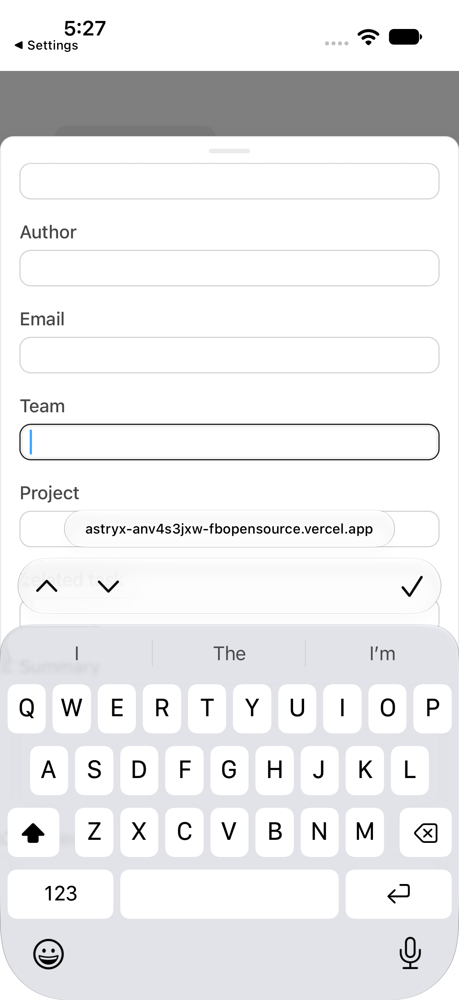
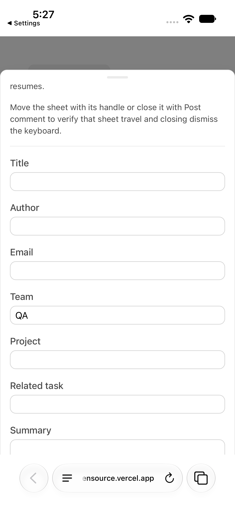

# Astryx PR #8742: partial iOS Simulator keyboard evidence

**Keyboard show, typing, and Done/full recovery are captured. Interactive dismissal leaving only the accessory bar is not verified, so the requested evidence gate remains open.**

## Build and environment

- PR: https://github.com/meta/astryx/pull/8742
- Captured revision: `40d77a28fc80f48e1baed66351a858550bc1655f`.
- Build provenance: the PR Analysis Report identified that exact revision and linked https://astryx-anv4s3jxw-fbopensource.vercel.app/storybook/ .
- Test page: https://astryx-anv4s3jxw-fbopensource.vercel.app/storybook/iframe.html?id=core-bottomsheet--mobile-keyboard&viewMode=story . This URL was opened directly in Simulator Safari as the top-level document, not embedded in the Storybook manager or Docs page.
- Device: iPhone 17 Pro Simulator, portrait; iOS 27.0, build `24A434`; Safari.
- Xcode: 27.0, build `27A266a`. Xcode commands used a per-command developer directory; global Xcode selection was not changed.
- Native display: 402 × 874 points, captured at 1206 × 2622 pixels.
- Main retained recording: October 30, 2026, beginning at 22:26:51 UTC.

`docs/specs/AST-099-mobile-keyboard/spec.md` is the current AST-099 record at the captured revision. FR7 and its platform-support section require a top-level document and genuine iOS Simulator or device evidence. This receipt covers the requested Tall-sheet case only, not the full FR2–FR5 matrix or physical-device release testing.

## Reproducible sequence

1. Open the test-page URL directly in Simulator Safari. Confirm the native software keyboard is available; a minimized keyboard with only an accessory bar does not establish keyboard-show evidence.
2. Tap **Add a comment** and keep the Tall sheet fully expanded.
3. Drag upward in the body's right margin, from approximately `(390, 670)` to `(390, 490)` screen points. Wait for scrolling to settle. Retain the pre-keyboard position.
4. Tap **Team**. Wait for the visible QWERTY keyboard and retain a screenshot.
5. Type `QA` and retain the focused field and keyboard.
6. Try a slow downward body-margin drag from `(390, 410)` to `(390, 790)`, then a downward drag near the prediction row from `(200, 570)` to `(200, 820)`. These are attempts, not successful keyboard dismissals in this run.
7. Tap the native accessory bar's **Done** checkmark. Wait for the keys and accessory bar to disappear. Retain the recovered sheet.

Native XCTest drove taps, typing, and drag gestures. The video came from `simctl io recordVideo`; the PNGs came from `XCUIScreen.main.screenshot()`. No browser viewport emulation, synthetic keyboard geometry, or source changes were used.

## Measured and observed results

- The pre-keyboard scroll moved Title from screen y=461 to y=298 points, and Team from y=689 to y=526: a 163-point content shift.
- When the keyboard appeared, Team moved to y=374, with a 25-point-high text-entry area. Its bottom at y=399 was above the accessory Done control beginning at y=493 and the QWERTY keyboard beginning at y=590. The focused field was visibly clear of the keyboard.
- Typing produced `QA` without losing focus. The settled Tall sheet's rounded top stayed at approximately y=119 points.
- After Done, Title returned to y=298 and Team to y=526, exactly matching the pre-keyboard positions in the native accessibility snapshots. `QA` remained. The keys and accessory bar were gone.
- The two recorded downward gestures did **not** hide QWERTY. The body scrolled while Team remained focused; that focused field could then sit behind the keyboard. These frames do not prove dismissal or accessory-only recovery.

## Missing stage and specific limitation

Three further native swipe trials targeted the keys, the accessory strip, and a longer body drag. QWERTY remained visible after each. The native XCTest `dismissKeyboard` helper looked for a **Hide keyboard** control, but no matching control was exposed on this iPhone configuration and the attempt failed. Later runs sometimes showed only the accessory bar with keys already off-screen; no verified native dismissal led to those states, so they are excluded from the evidence claim. Hardware-keyboard connection state was not confirmed.

A reproducible native dismissal that hides QWERTY while leaving the accessory bar is still needed. Do not mark that stage, the complete requested capture, or the evidence gate as passed from this receipt.

## Capture

[Watch the verified partial recording](tall-keyboard-partial.webm).

### Visible software keyboard

### Full recovery after Done

## Retained files

- `tall-keyboard-partial.webm`: browser-playable copy, 29.566 seconds, VP9, 1206 × 2622, YUV 4:2:0, limited/TV color range, 30 fps. Leading setup was trimmed; the source timestamps were normalized during re-encoding. This is not a measurement of native refresh rate or keyboard animation timing.
- `01-tall-open.png` through `07-full-recovery.png`: unaltered native screenshots. Files 05 and 06 explicitly show unsuccessful dismissal attempts.
- `ffprobe.json`: media-format verification. The complete browser copy also decoded without errors.
- `SHA256SUMS`: retained-file integrity hashes.

The original native recording and XCTest result bundle remain outside the repository. The evidence work made no repository edits, commits, pushes, PR comments, thread changes, or merges.
